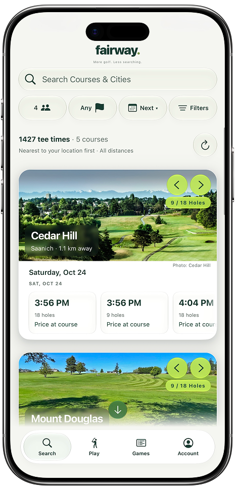
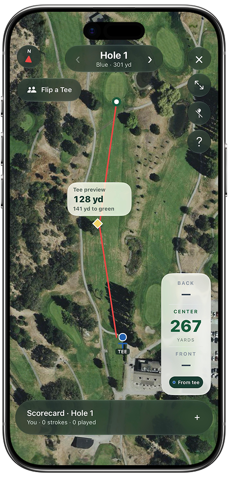
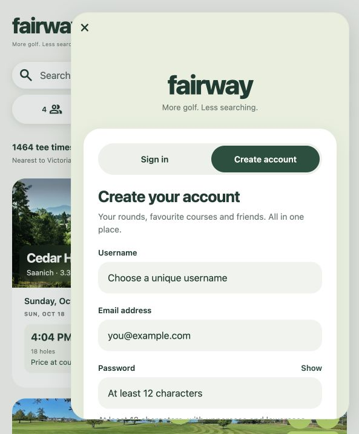
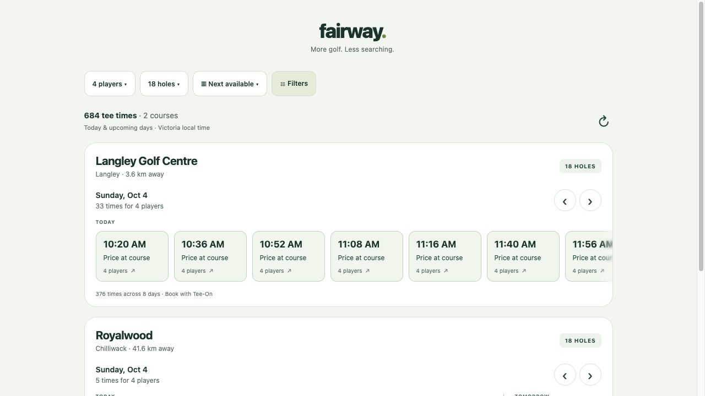

# Fairway

## Project Overview
Fairway helps golfers compare live tee times across supported BC courses and track a round on their phone. It is a software capstone built with Expo, React Native, React, TypeScript, Node.js and Express.

**Release status:** development prototype. Signed iPhone internal preview builds are available; the web app is live at https://fairway-bcsq.onrender.com on Render Free. Store releases are still pending. Free hosting sleeps when idle and can take 50+ seconds to wake. Native map screens compile but still require device and on-course testing. See [architecture](docs/ARCHITECTURE.md) and [development log](docs/DEVLOG.md).

## Visual identity and mobile experience

<p align="center">
  
</p>

<p align="center"><strong>Fairway</strong><br><em>More golf. Less searching.</em></p>

The mobile experience is designed around quick course discovery, a focused Play flow, and on-course round tracking. These previews show the phone-first interface and the Fairway visual language used throughout the app.

<table>
  <tr>
    <td align="center"></td>
    <td align="center"></td>
    <td align="center"></td>
  </tr>
  <tr>
    <td align="center"><sub>Tee-time search</sub></td>
    <td align="center"><sub>Play and rangefinder</sub></td>
    <td align="center"><sub>Account and friends</sub></td>
  </tr>
</table>


## Features
- Live tee-time rows for Ardmore, Cedar Hill, Olympic View, Mount Douglas, Langley Golf Centre and Royalwood, subject to provider availability.
- Default four-player search, chronological multi-day carousels, bookable-date calendar, holes/time/price filters and alphabetical or distance sorting.
- City or opt-in GPS search; approximate straight-line distances.
- Provider-specific booking handoff. Some providers require reselecting the time or signing in; Fairway does not process reservations or payments.
- Native satellite rangefinder using Apple Maps on iOS and Google Maps on Android, with opt-in GPS, accuracy indication, recentering and manually selected targets.
- Full-screen native round view and slide-up score entry for 1–4 players, with account-owned cloud rounds, local guest history and 9/18-hole scorecards.
- Expiring availability snapshots, malformed-response rejection and independent provider failures.

Hole maps orient the tee below the green and support tap-to-measure targets. Front/centre/back distances use mapped green boundaries where available; missing boundaries do not produce invented front/back yardages. Several layouts are approximate pilots awaiting field verification. Rangefinder and scoring are native-only. Supabase provides account authentication, profiles, favourites, friends and round sync; hosted setup gaps are documented in [capstone readiness](docs/CAPSTONE-READINESS.md).

## Installation Instructions
For developers and assessors. End users will use the published link or installed mobile app.

Use Node.js 22.13 or later in the 22.x line and npm. From the project directory:

```sh
npm ci
npx expo export --platform web
npm run server
```

Open http://127.0.0.1:8787. The Express server serves the exported website and availability API together. Live provider requests need internet; initial inventory fills in the background. `PORT` and `HOST` override the default `8787` and `127.0.0.1` bindings.

For native development, set `EXPO_PUBLIC_API_URL` to the backend's reachable HTTPS origin, then run `npm start`. Follow Expo's development-build workflow for a signed device build. A phone cannot reach your desktop through `127.0.0.1`. Android release maps still require a restricted Maps SDK key and native configuration; iOS uses Apple Maps.

For browser UI development, use `npm run web` with an appropriate same-origin API proxy. The exported build served by Express is the supported local end-to-end preview.

## Usage
1. Select players, holes and location/radius. Next available is the default; choose a bookable date to narrow results.
2. Swipe each course row through its available times and days.
3. Select a time, review the details and continue to the official provider to complete booking.
4. On mobile, open Play, select a course, tees, holes and players, then start a round.
5. Tap the score menu to enter strokes. Enable GPS and tap a map target to measure approximate yardage. Hole navigation smoothly frames mapped holes.
6. Games shows fully completed rounds. Signed-in rounds sync to the account; guest rounds stay on the device. Discarded rounds do not enter completed history.

## Technologies Used
- Expo SDK 57, React Native, React, Expo Router and TypeScript.
- Node.js, Express and Cheerio for server-side availability adapters.
- Expo Location and react-native-maps for native GPS/maps.
- Supabase Auth, PostgreSQL row-level security and private avatar storage.
- SecureStore for native sessions; AsyncStorage for guest scores and caches.
- Node's test runner, TypeScript and ESLint for automated checks.

The database is PostgreSQL through Supabase. The student confirmed instructor approval for this database choice on October 18, 2026.

## Testing and Debugging
```sh
npm test
npm run typecheck
npm run lint
npx expo export --platform all
```

Tests cover parsing, capacity restrictions, booking windows, date rollover, pagination, cache expiry, filters, booking links and score validation. GitHub Actions is configured to run checks and export all platforms on pushes and pull requests; the first hosted run passed on October 18, 2026. See [validation evidence and remaining device checks](docs/VALIDATION.md).

## Security and Deployment
Keep provider credentials server-side. `.env` files and signing credentials are ignored; `.env.example` contains placeholders only. `EXPO_PUBLIC_*` values are bundled into clients and must never contain secrets. Native map keys require platform restrictions even when supplied through environment configuration.

A temporary desktop tunnel is a development preview. The current web/API deployment is `https://fairway-bcsq.onrender.com` on Render Free; it provides HTTPS and a stable URL but may sleep when idle. A paid always-on service, monitoring and restricted production keys remain release improvements. Source: https://github.com/Buchanz/fairway.

## Future Improvements
- Verified course geometry, green distances and on-course accuracy validation.
- Additional authorized course/provider integrations, including Lightspeed.
- Store distribution and permanent hosted backend.
- Accessibility/device testing and broader automated UI coverage.
- Complete hosted-account acceptance testing, verified pars and richer round statistics.

## Development Evidence
[Devlog](docs/DEVLOG.md) · [Project proposal](docs/PROPOSAL.md) · [Architecture](docs/ARCHITECTURE.md)



### Accounts and cloud rounds
Account UI is connected to a Supabase development project. Email delivery, callback configuration, pending migrations and authenticated acceptance testing still require completion. See [account setup and validation](docs/ACCOUNTS.md). Native tokens use SecureStore; authenticated rounds are protected by owner-only database policies. Guest rounds remain on the device and are not automatically imported. The availability API continues to use Express.
