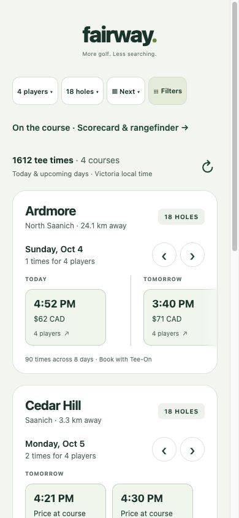

# Development log

## 2026-09-25 — Exploratory prototype
- Selected golf based on personal interest and a clearly defined search problem.
- Initialized an Expo/React Native/TypeScript project with web support and Expo Router.
- Built search, filters, empty results, and course details with fictional inventory.
- Separated filtering and inventory types from screens so a real provider can be integrated later.
- Added tests for group capacity, combined filters, and unmatched searches.
- Main risk: reliable access to tee-time inventory. Region and providers still need validation.
- Accounts, persistence, live booking, and deployment are not implemented yet.

## 2026-09-26 — Greater Victoria directory
- Replaced the visible fictional inventory with Highland Pacific and Cedar Hill, using official course and booking links.
- Added Victoria/Langford/Sidney search origins, 10/25/50/100 km radii, municipality/name search, hole filters, and nearest-first results.
- Added optional foreground location with denial, timeout, and superseded-request handling. Coordinates remain in component memory and are not saved or sent to a provider.
- Added explicit unavailable-in-app status and official website handoff; removed price/day/player filters from the directory until they can act on real inventory.
- Investigated Tee-On public pages; third-party live-data access remains unverified. See LIVE-DATA.md for evidence and a draft inquiry (not sent).

## 2026-09-26 — First live availability adapter
- Verified Olympic View's public HTML contains current-day tee times and matched times, displayed CAD prices, holes, and allowed group sizes against its browser page.
- Implemented Express endpoint, HTML parsing, timeout, shared cache, error backoff, malformed/stale-date rejection, and a live UI with group filtering and expiry.
- Highland Pacific returned an automated-access challenge; no bypass attempted. Chose another publicly accessible course for the first integration.
- Current limitation: today only, separate from directory radius filters, native backend URL and deployment still pending.

## Course-row redesign
- Replaced the directory plus separate live panel with one row per course.
- Moved player selection to the top; connected slots filter by exact supported group size and sort chronologically left to right.
- Added Filter & sort panel with A–Z and nearest-first, current location or city centre, and radius.
- Integrated Olympic View into the location-aware catalogue. Approximate clubhouse coordinates sourced from https://www.where2golf.com/canada-bc-alberta/olympic-view-golf-club/.
- Availability loads on opening the page; stale data expires, past slots are removed, and errors stay distinct from no matches and unconnected courses.
- Today-only limitation remains. Selecting a slot opens the provider where the user must reselect the slot to book.

## Cedar Hill live guest integration
- Found the current official booking link to Tee-On's newer portal; earlier assumptions based on the legacy Highland Pacific flow did not apply to Cedar Hill.
- Connected public guest availability to the existing course row and added date selection.
- Added capacity/guest-restriction/invalid-data tests; no invented prices.

## Next available day by default
- Added automatic day-by-day live search for the selected player count and location radius, from today through four days ahead.
- Expired times are ignored in Victoria local time; the dashboard advances to the first date with matching availability. Manual date selection remains available.
- Provider failures stay distinct from fully booked days; results explain when only some courses could be checked.
- Added late-night, player-capacity, month-boundary and daylight-saving date tests. All 16 tests, TypeScript, lint and web export passed.

## Show only courses with tee times
- Course rows and the result count now include only fresh, matching tee times for the selected date and group size.
- Courses with no availability, expired data or provider errors are hidden. Loading, empty results and incomplete coverage are communicated at the search level.
- TypeScript, lint and web export passed.

## Compact players and bookable-date picker
- Replaced persistent player chips with a single player menu and removed relative-day tabs.
- Added a calendar quick view beside players. It checks the supported five-day window and only offers dates with fresh matching live availability for the selected group and radius.
- Date selection loads that day's course rows; Next available restores automatic search. Unknown, empty and expired dates cannot be selected.
- Typecheck, lint, all 16 existing tests and web export passed.

## 2026-09-28 — Cedar Hill first, preloaded availability
- Focused visible results on Cedar Hill. Removed sequential browser day searches and calendar requests.
- Server preloads all five supported dates before listening, refreshes every 30 seconds, and embeds a fresh snapshot in the web page. Native clients fetch the same snapshot endpoint.
- Player/date changes filter the existing snapshot immediately. Background refresh preserves results; records older than two minutes are excluded after upstream failures.
- Verified initial page contains four-player times and selecting another date updates immediately without loading messages. All 19 tests, typecheck, lint and web export pass.
- TeeClub search listing and App Store describe aggregated live search. Direct website inspection was blocked by a certificate error/403, so an exact visual reproduction has not been verified.
- Initial network/page load still takes time; this change eliminates sequential provider waits during web search interaction. Native first launch still needs its snapshot response.

## Full Cedar Hill release window
- Verified Saanich's official policy: bookings open at 6pm five days before play.
- Snapshot and date endpoint now cover offsets 0–4 before 6pm and 0–5 after 6pm in Vancouver time. The carousel already includes every matching slot across returned dates.
- Added release-boundary and winter/year-rollover tests; all 22 tests, typecheck and lint passed.
- TeeClub's published FAQ says every result links to the course booking page. Native Fairway checkout remains unimplemented pending a supported reservation integration; availability access is not booking access.

## 2026-09-28 — Coverage audit and search redesign
- Audited Cedar Hill, Olympic View, Cordova Bay, Highland Pacific, Bear Mountain, Metchosin and Ardmore. Documented official sources and blockers in COURSE-COVERAGE.md. No claim of two new working integrations: Club Prophet/Chronogolf requests were blocked and legacy Tee-On access remains unresolved.
- Added multi-course snapshots with independent provider failure handling. Retained Olympic View's existing same-day adapter alongside Cedar Hill's advance dates.
- Added supported Cedar Hill 9-hole rounds and explicit 9/18-hole, time-of-day and known-price filters. Price limits exclude unknown prices instead of implying free golf.
- Rebuilt the mobile search layout with compact controls, lighter time cards, independent course carousels and date headings, desktop navigation arrows, coverage details and a booking review panel.
- Review panel confirms selected course/date/time/group/holes, explains provider handoff, and disables continuation if the latest snapshot no longer confirms the slot.

## October 3 — full booking windows and Mount Douglas

Fixed Olympic View date searches by excluding booking rows and the unrelated image-submit control from the public search form. Verified the provider's full 91-date calendar, October 3–January 1. A second issue emerged: ANYTIME searches return a maximum of 24 results. Overlapping hourly searches now retrieve later times and deduplicate them. The completed live sweep returned 4,095 time offers, including 48 on December 31; four queried dates had no offers. These are observations at verification time, not guaranteed remaining inventory.

Added Mount Douglas through its official Tee-On booking page. Verified all eight published dates through October 10 and both 9/18-hole offers, with prices and exact permitted party-size ranges. Default four-player/18-hole search now shows three live courses. Calendar selection on October 10 showed both Mount Douglas and Olympic View; December 31 showed 48 Olympic View times.

Replaced the eagerly rendered horizontal carousel with FlatList, preserving day spacing and changing the heading as the next day enters view. Verified the heading changed from Monday to Tuesday when scrolling Mount Douglas. Tests cover date-window discovery, the 24-result cutoff, overlap deduplication, excluding booking controls, future morning times, source errors and cache expiry. Type checking, lint, web build and 37 automated tests pass.

Remaining limitations: first startup fills the full Olympic window progressively; Olympic snapshots expire after ten minutes to accommodate its slow public HTML source. Bookings still finish on provider websites. Unconnected courses remain hidden rather than showing invented availability.

## October 3 — Ardmore integration

Generalized Mount Douglas into a shared Tee-On adapter and added Ardmore's eleven published dates. Fixed discounted IDs such as ARDMF8... while preserving exact group-size restrictions. Verified October 4 and October 13 live inventory. Typecheck, lint, web export and 39 tests passed. Investigated all remaining requested sources; server access remains blocked despite some browser views working. Prepared unsent access requests in PROVIDER-ACCESS.md.


## 2026-10-04 — First mainland feeds
Connected Langley Golf Centre (LANB/11665) and Royalwood (RYWD/11953) through their official public guest Tee-On links. Verified every advertised date, October 4–11. Langley returned 915 offers across 9/18 holes; Royalwood returned 359 offers at verification time. Counts change as bookings occur. Langley explicitly leaves the price element blank, so only its configured adapter allows null prices; malformed prices still fail closed. No private API credentials are used.

Removed the Island-only geographic restriction; added Langley, Vancouver, Nanaimo and Chilliwack search origins. Select Langley with a 50 km radius to see both new courses. Existing Victoria defaults remain local. Booking redirects use the official provider and may require reselecting the time. Coordinates are approximate OpenStreetMap course centres (ways 808599734 and 25311768).

Official sources: https://www.langleygolfcentre.com/golf-rates-and-online-bookings and https://royalwoodgolf.com/ . Arrowsmith now links to TeeItUp; Cottonwood uses a different search flow; neither was enabled in this batch.


## 2026-10-04 — On-course prototype and mobile header
Mobile search controls now use one row and a shorter Next date label. A shared measured wordmark keeps the tagline aligned on both header sizes. Added /play with 1–4 player, 9/18-hole stroke scorecards, local persistence, totals, partial rounds, history and reopening. Browser persistence verified by recording a score and reloading.

Rangefinder prototype uses Leaflet 1.9.4 and attributed OpenStreetMap tiles with user-selected targets, opt-in foreground browser GPS, accuracy and stale-fix handling. No verified green coordinates, automatic hole recognition, satellite imagery, pars, handicaps, account sync or offline map downloads are included. Native WebView support is implemented but has not been device tested; set EXPO_PUBLIC_API_URL for the mobile build. GPS accuracy must be field tested. Temporary web origins each have separate score storage.

## 2026-10-05 — Native rangefinder foundation
- Replaced the native web-map wrapper with react-native-maps satellite rendering (Apple on iOS, Google on Android).
- Added explicit foreground GPS permission, location accuracy radius, selected-target yardage, recenter/clear controls and stale-position messaging.
- GPS subscriptions are removed on background/unmount; pending permission/watch requests are guarded against late completion.
- Retained the separate browser map preview. Course pins are not represented as verified green targets.
- Added a dated two-week beta/release checklist. Device builds, Android key configuration, verified hole geometry and field testing remain outstanding.
- Validation: 42 existing tests pass; TypeScript and lint pass; iOS and Android JavaScript bundles export successfully. These checks do not replace native installation or GPS field testing.

## 2026-10-05 — Mobile round screen
- Native rounds now open on a full-screen satellite map with safe-area-aware floating hole controls and a scorecard bar.
- Added a slide-up multiplayer score panel, previous/next hole controls, persisted score editing and finish-round confirmation.
- Map targets remain separate for each hole without restarting GPS when navigating between holes.
- Kept native map imports out of the browser bundle. Typecheck and lint pass; platform bundles export. Native device visual/GPS validation remains outstanding.

## Week of September 28 — Debugging reflection
The main discovery was that a valid provider response did not necessarily contain every tee time: Olympic View limited results to 24. Comparing later-day searches exposed the missing offers, leading to overlapping time searches and deduplication. Another failure came from submitting unrelated booking controls with the date-search form. Restricting submitted fields corrected the request. Tests now exercise these failure modes. Learning: validate completeness and request semantics, not merely HTTP success.

## Week of October 5 — Mobile and rubric alignment
Separated native satellite maps from the browser preview and added round controls without replacing the saved-score model. GPS lifecycle required guarding asynchronous permission/watch requests so leaving the screen cannot create an orphaned subscription. Learning: native resource cleanup is part of correctness, and successful bundling is not evidence of accurate GPS or usable native UI.

Audited all six rubric categories. Replaced the outdated README, documented actual architecture/state/data flow, drafted the proposal, added an environment example and configured GitHub Actions. Public hosting/repository, verified green geometry and device tests remain explicitly incomplete. The proposal document does not establish instructor approval.

### Milestone screenshots
Mainland search after adding Langley and Royalwood:


Earlier mobile search/score prototype (before native satellite screens):



### Code milestone: scores exclude unplayed holes
From `src/lib/rounds.ts`:

```ts
export function scoreTotal(scores: (number | null)[]) {
  return {
    total: scores.reduce<number>((n, v) => n + (v ?? 0), 0),
    played: scores.filter(v => v !== null).length,
  };
}
```

A blank hole is not counted as played. This distinction keeps partial-round totals and progress meaningful and is covered by an automated test.

## 2026-10-08 — Match round setup to booking results
Round setup now receives the course IDs visible in the tee-time search when opened, instead of listing every connected course. Location and availability filters therefore carry through to new-round course choices. Empty search results disable new-round creation, while existing saved rounds remain accessible. This is a search-result handoff, not a reservation or a guarantee inventory remains available later. Typecheck and lint pass.

## 2026-10-08 — Round permissions and header
- Narrowed and centered native hole navigation, moved close to the right and added a GPS/recenter control on the left.
- Starting/resuming a round checks OS location permission before opening it. Existing grants are reused; denial offers Settings or scorekeeping without GPS.
- Native maps start foreground tracking automatically with granted permission and restart on return from background. No background-location permission is requested.
- Investigated public hole geometry through two Overpass endpoints: the first returned a non-JSON response and the second HTTP 500. No geometry was imported or invented. Automatic hole framing and front/centre/back distance markers remain incomplete pending validated tee/green geometry.
- TypeScript and lint checks passed. Physical-device layout and permission checks still require user testing.

## 2026-10-08 — Cedar Hill hole-by-hole rangefinder
The Overpass service remained unavailable, but the primary OpenStreetMap bounding-box endpoint returned all 18 Cedar Hill hole paths. Imported source way IDs, ordered coordinates and pars with ODbL attribution. Added tee-to-green camera bearing/zoom, mapped markers, distance line, tap-to-target tee carry and remaining green distance. Switching holes reframes the map; the scorecard Next hole action closes the sheet. Added three geometry tests (45 total passing). Data represents approximate mapped references, not current pins or selectable tee sets; native field verification remains necessary.

## 2026-10-09 — Additional hole layouts and unobstructed map
Added complete Olympic View and Royalwood geometry using the same hole camera and shot-measurement behaviour as Cedar Hill. Missing Royalwood pars remain unknown. Three other connected courses lacked numbered hole ways in the downloaded map areas; no substitute geometry was invented.

Removed the large panel above the scorecard, retained distances on map markers and compact map controls, and reduced camera padding to use the freed space. Configured native Apple compass placement and bottom-left Apple logo insets, removing the custom iOS target button. Actual compass placement may depend on the native maps implementation: the installed source exposes compassOffset but no positioning implementation was found, so device validation/native follow-up remains required.

## 2026-10-09 — Search and course discovery
Removed the default 50 km cutoff; all connected courses with fresh matching tee times are eligible by default. Nearest-first sorting is the default, with A–Z and optional distance limits retained. Previously granted foreground location permission is reused to obtain the origin; otherwise the selected town is clearly labelled. Added a course/town search field above normal and sticky filters and a native-only golf-club button for round tracking. Typecheck, lint and all platform bundle exports pass; the served web export was refreshed.

## 2026-10-09 — Wider hole framing and adjustable aim
Increased camera fit margins and viewing distance for all mapped holes to give tee/green labels more space around overlays. New holes initially display an adjustable aim point halfway along the mapped hole path, following doglegs rather than the straight tee-to-green chord. Tee-to-aim and aim-to-green lines replace the direct line until the target is cleared. Tap or drag to change the target; restore the suggestion with its compact control. The suggestion is a geometric planning aid, not a verified fairway-centre, hazard-aware or club-distance recommendation. Added tests for doglegs, repeated nodes and degenerate paths. Physical phone framing remains to be verified.

## 2026-10-09 — Compact Play control
Moved the native round entry into the same non-wrapping row as player, hole, date and filter controls. Renamed it Play and added a subtle animated border pulse plus hover/press feedback. The pulse stops for hidden toolbar copies and respects Reduce Motion. The web remains booking-only.

## 2026-10-09 — Rangefinder control styling
Unified shot lines to solid red, width 3, and omitted stale GPS-to-target lines. Moved a compact GPS switch directly below the hole selector; right-side frame/clear/restore controls are dark circles beneath close. The collapsed scorecard is a matching dark pill with light text. Added an iOS top-left custom compass driven by map-camera heading with a north-reset action; this replaces the unreliable native compass positioning in Expo Go and is not Apple's native compass widget. Native visual/device verification remains outstanding.

## October 9 — GPS yardage display
Replaced the suggestion caption with target yardage, added a tee-and-ball marker, and added a rounded back/center/front card. Fresh GPS drives measurements, including when off-course; unavailable or stale GPS falls back to an explicitly labelled tee preview. Added mapped green polygons and source IDs where the existing OSM geometry supports a unique match. Missing front/back data stays blank instead of fabricating green dimensions.

Validation: typecheck and lint passed, all 50 tests passed, and iOS/Android bundles exported successfully. New geometry tests cover changing player position, reversed approach direction and missing boundaries. On-course GPS accuracy and visual layout still need physical-device verification.

## October 9 — Rangefinder overlay spacing
Moved the yardage card to the lower right above the scorecard, returned map controls to the upper right, and reserved a safe-area-aware attribution row below the scorecard. GPS notices leave room for the yardage card. Green outlines remain limited to mapped source boundaries. Typecheck and lint passed; physical-device visual verification remains pending.

## October 10 — Expanding scorecard
Replaced the separate white sliding modal with one bottom-anchored dark panel. Its height and corner radius animate from the original pill, score controls fade in, and the backdrop gradually dims and clears over the same transition. Closing reverses the animation; Android back collapses the panel. Hidden score controls are excluded from accessibility navigation. Yardage values fit on one line and map action buttons sit ten pixels below the close button.

Typecheck and lint passed. Native bundle export checked separately; phone animation and map rendering still require device review.

## October 10 — Unmapped course diagnosis
Mount Douglas, Ardmore and Langley have booking integrations but no numbered tee-to-green geometry in the bundled datasets. Rechecked source OSM extracts: none contains golf=hole ways; partial unnumbered geometry cannot safely identify the holes. Official course material exists at https://mountdouggolf.ca/about/ , https://www.ardmoregolfcourse.com/our-course.html and https://www.langleygolfcentre.com/golf-rates-and-online-bookings but has not been converted into verified geographic hole coordinates.

Added manual-map labels and capability explanations before starting a round and clarified GPS target measurement within the map. Scorekeeping remains available. This does not complete automatic hole tracking for these three courses; verified numbered coordinates are still required.

## October 10 — Playing tees and expansion research
Added persisted round tee selection. Cedar Hill Blue/White/Red sets include all 18 published scorecard yardages, totaling 5,164/4,977/4,740 yards, sourced from https://www.golfify.io/courses/cedar-hill-golf-course and linked from setup. Round header and score panel show the selected tee's hole yardage. Other courses accept an optional tee label with an explicit notice that tee-specific yardages are unavailable. Existing saved rounds remain compatible. GPS front/center/back stays tied to player position; no tee coordinates were invented from scorecard lengths.

Identified seven additional BC booking candidates (see COURSE-EXPANSION.md). Their public availability checks failed, as did an existing Royalwood control: its HTTP 200 body was empty. No new course is claimed live from these checks. Added tests for published tee totals, unknown selections, persistence and old-round compatibility.

## October 10 — Mt Doug mapping pilot
Used the official 2025 scorecard to identify nine holes and their pars, then matched visible mats/green centers to Saanich's May 2025 georeferenced orthophoto. An illustrated map cannot be treated as uniformly scaled; the aerial export's actual WGS84 extent supplies the pixel-to-coordinate transform. Added reproducible mapping input and conversion script plus a drag-point review editor. Source attribution now supports non-OSM layouts.

Enabled pilot hole framing and the standard mat scorecard, including second-circuit mapping for 18-hole rounds. No green outlines were guessed. Hole 2 retains an explicit review note because mapped distance differs by 14 yards from the scorecard. All positions remain approximate and require course/field validation. Visual QA overlaid all nine paths on the source aerial. Native map rendering and editor interaction have not been tested on a physical device.

## October 10 — Mt Doug tee corrections
User review identified holes 1 and 2 as misplaced. Closer aerial inspection located the first rectangular tee mat beside the clubhouse path and the second teeing pad beside the creek crossing. Updated source pixels, bundled coordinates and review editor seed together. The estimated straight-line lengths are now 222 and 93 yards, versus 217 and 85 on the scorecard; geographic positions remain image-based pending field confirmation.

## 2026-10-10 — Compact mobile round setup
- Replaced the course chip wall and global recent-round list with a single course card and search sheet. A foreground GPS fix suggests the nearest connected course; an explicit user choice is preserved if GPS arrives later. Denied/unavailable location leaves manual search available.
- History is scoped to the selected course and opened separately. Player names/count are edited in a sheet, keeping the main setup compact with 9/18-hole controls and a start button.
- Automatically select the sole tee set (including Mt Doug Standard mats), omitting the redundant Not selected option. Existing saved rounds remain intact.
- Validation: TypeScript, Expo lint and all 53 tests passed. Native bundle export checked separately. Physical-device layout and GPS suggestion still require phone verification.

## 2026-10-10 — End-round confirmation and history cleanup
- Rangefinder X now prompts Keep playing / End round. Confirming marks the round finished, preserves scores and returns to setup. Already-finished rounds close without changing status. Android back collapses an open scorecard first, then uses the same confirmation.
- Course history supports swipe-left to reveal Delete, with a destructive confirmation and an accessibility delete action. Deletions use the existing serialized device-storage save flow.
- Typecheck, lint and 53 tests passed. Native bundle exports checked; physical-device gesture validation remains outstanding.
- Accounts and server-backed, user-scoped round storage remain future work. Round history currently lives only on the device.

## 2026-10-10 — Tee colours and history polish
- Removed Not selected from tee choices; the first available tee is now selected by default and persisted when starting a round. Coloured tee buttons use white labels, a selected checkmark and border. White tees retain a white button with a dark label backing for readability.
- Removed round status labels from course history. Swipe capture now takes precedence over the row press for horizontal gestures, and Delete is visible while dragging rather than only after release. Deletion still requires confirmation.
- Typecheck and lint passed; phone gesture verification remains necessary.

## 2026-10-10 — Account and cloud-round foundation
- Added Supabase Auth signup, email-code confirmation/resend, password recovery, login/logout and confirmed self-service deletion. Native sessions use SecureStore; browser sessions remain memory-only.
- Added PostgreSQL migration for owner-scoped rounds with RLS and cascade deletion. Kept the existing Express availability backend. PostgreSQL choice remains subject to instructor MongoDB requirements.
- Authenticated play loads cloud rounds; guest rounds retain their original device storage. Account changes remount play state. Saves serialize changed-round upserts and explicit deletes, avoiding removal of unseen rounds from another device.
- Added four tests for user-scoped local storage, corruption preservation, changed-round saves and scoped deletions. All 57 tests, typecheck and lint passed. Added a live two-account isolation script, but it cannot be run until a Supabase project and test accounts are configured.
- Remaining external setup: project URL/public key, SQL migration, email templates with OTP, SMTP, and live signup/reset/isolation/device checks. No claim of production readiness; guest import, durable offline queue and concurrent round editing remain future work.

## 2026-10-11 — Native iOS Liquid Glass surfaces
- Added SDK-matched expo-glass-effect and shared GlassPanel, GlassPressable and GlassInput components. Native glass is gated on runtime availability and the user's Reduce Transparency setting, with existing solid surfaces on unsupported platforms.
- Applied materials to booking/filter controls, search/account fields, course cards, tee-time tiles, booking review, round setup/tee choices/history sheets, map X/compass/GPS/target controls, hole selector, yardage card and animated scorecard.
- Preserved tee colours and White tee black text, native press handlers/ref measurement, and scorecard size/radius animation. Glass-containing fade animations avoid zero opacity per Expo's documented native rendering limitation.
- Validation: typecheck, lint, 57 tests and iOS/Android/web exports passed. Native glass appearance, scrolling performance and map-overlay legibility still need physical iOS 26 device verification; no simulator/device render was available here.

## 2026-10-13 — Glass interaction, stable selectors and bottom navigation
- Tee selection no longer inserts a checkmark into the label; selection uses opacity and accessibility state without changing its measured width. Removed custom strokes from glass-backed controls and panels.
- Moved touch targets inside interactive GlassView surfaces so native glass receives descendant touches. Preserved solid fallbacks and native accessibility settings.
- Made round search, nearest-course card, Start Round, and home search/filter controls pill-shaped. Removed the nested player-count pill and capitalized Player/Players.
- Added a custom native-glass bottom navigation bar for Tee Times, Play and Account on mobile. It is not Apple's UITabBar; it uses the shared native GlassView material. Full-screen rounds do not render it.
- Back to Tee Times dismisses to the existing home route instead of pushing it; stack transitions explicitly slide from the right.
- Typecheck, lint and 57 tests passed; platform exports checked separately. Native touch feedback, transition direction and small-phone fit still require device verification.

## 2026-10-13 — Persistent navigation and profile page
- Hoisted mobile navigation outside the screen stack so the same glass bar stays mounted across route changes. Its only selection pill animates between SF Symbol tab icons; individual tabs no longer have separate glass backgrounds. This remains a custom bar using native glass, not UIKit UITabBar.
- Tab transitions use no page-slide animation; circular back-chevron controls enable a rightward pop. Full-screen rounds hide the bar via shared visibility state. Removed the duplicate home Play control.
- Unified home filters/search with the Filters material and centered the Search Courses & Cities placeholder.
- Added profile avatar upload, email-change request, recent games and editable favourites. Guest rounds/favourites stay local; authenticated features use Supabase. Added private avatar storage policies; live uploads and email changes await project configuration.
- Typechecking, lint, tests and platform exports validated. Physical-device animation/keyboard/photo-picker checks and live storage isolation remain outstanding.

## 2026-10-13 — Setup and account layout refinement
- Expanded the four home filters evenly to the search width; search text is left aligned and vertically centered, with Clear overlaid to preserve width.
- Compact centered Account/Start a round headers align with back chevrons. Round setup uses a rounded rectangular glass course card, left-stacked hole controls, Tees label and a bounded 1–4 player stepper; tapping Players still edits names.
- Added shadows to shared glass surfaces. Tab selection now translates one stable glass layer with the native animation driver rather than updating glass layout each frame.
- Recent Games is one entry opening a sheet with its own back control. Display name and self-reported handicap save in user metadata, or separate guest storage. Sign out remains available when authenticated.
- Typecheck, lint, all 57 tests and iOS bundle export passed. Native visual QA remains on-device; live database/auth configuration is still pending.

## 2026-10-13 — Search / Play / Games / Account
- Added Games as the third mobile tab and renamed home to Search. The persistent glass highlight now measures four equal tab positions.
- Games refreshes on focus and shows all saved rounds newest first, every player's total and played-hole count, expandable hole-by-hole scores, and confirmed swipe deletion. Signed-in rounds stay user-scoped; guest history stays on the device.
- Removed recent-round history from Account, leaving profile, email, favourites, and account management there. Web remains booking-only.
- Typecheck, lint, 57 tests and iOS export passed. Native layout/gesture checks remain on-device.

## 2026-10-13 — Inline course search and menu geometry
- Start-a-round course search now focuses the existing top text field with a larger SF Symbol magnifier. Results appear in an anchored dropdown; selecting a course dismisses the keyboard. Removed the separate search modal.
- Moved swipe-row shadow to an outer unclipped wrapper while keeping delete-reveal content clipped inside matching corners.
- Fixed Next/Filters popup sizing near the right edge: size against screen width then shift inward. Added spring-based bounds/corner morphing with reduced-motion support and matching glass tint. These are custom morphing surfaces, not native system menus.
- Typecheck and lint passed; iOS bundle export checked. Touch/keyboard and glass motion still need phone verification.

## 2026-10-13 — Completed games and filter selection
- Games now displays only rounds marked finished with valid scores for every player on every hole. Incomplete rounds stay stored, so deleting a completed game cannot discard hidden unfinished rounds. Added coverage for complete 9/18-hole games, active games, early ends and incomplete multiplayer cards.
- Selected filter chips/dates use a deeper green with white labels; selected native glass receives a stronger tint to preserve contrast. Unselected chips use pale glass. Button geometry stays unchanged.
- Typecheck, lint and 58 tests passed.


## October 13 — Glass interaction and screen layout pass

- Removed scroll-driven brand relocation, moved course carousel controls to the upper right, added glass hole badges, and removed repeated small labels. Search and Play share the same focus-reactive search field.
- Removed the extra pressed background from native glass controls; added translucent web surfaces, larger cross-platform filter icons, interactive steppers, and a draggable tab selection indicator. Web retains no bottom tabs.
- Round setup requires an explicit course selection. Hole/tee controls align right; empty Games links to Play. Root Account/Games have no back button. Course history uses an iOS page sheet with a top-left close button.
- Profile photo selection requests library permission first; guest pictures remain on-device, authenticated uploads retain the private storage flow. Added native build permission text.
- Rangefinder controls use descriptive symbols. The green-distance panel opens the morphing guide, which explains red measurement lines, yellow targets, tee colours, and GPS/preview accuracy. Tee colours do not imply separately surveyed tee-box coordinates.
- Refresh rotates while fetching and fades the results. Typecheck/lint passed; 58 existing tests passed. iOS/Android/web exports passed. Browser smoke checks covered cards, menu opening/closing, search, and refresh. Physical iPhone gesture/material/picker verification is still needed; cloud avatar upload remains dependent on configuring Supabase.

### Follow-up — tab bar crash and web styling regression

The iPhone screenshot identified a layout callback calling `measureInWindow` on the Expo GlassView ref, which does not expose that method at runtime. Measurement now uses a separate, non-collapsible React Native View around the glass tab bar. Restored the web components' own backgrounds, borders and hover styles instead of applying translucent fills and heavy shadows globally. The requested layout changes remain. Typecheck/lint and web export verified; physical iPhone verification remains outstanding.


### Aligned Search and Play headers

Restored left-aligned hole, tee and player controls below their labels. Removed the root Play back button; sheet close controls remain. Both screens now use a 44-point header, an 8-point gap and the same 44-point search field with centered icons. Home uses the compact brand above search. Save errors appear below search so they cannot shift its starting position.


### Refresh, chevrons and tab hover

Refresh now completes whole 700 ms linear revolutions, including fast cache responses. Carousel arrows use centered SF chevrons with Material equivalents. Removed custom shadow/elevation layers from native glass to avoid a static silhouette beneath the deforming material; web styles are unchanged. Tab gestures retain one responder across route changes and reveal each tab while dragging, suppressing route-driven indicator animations until release. Typecheck/lint and iOS/web exports checked. Native glass deformation and continuous dragging still require device verification.


## October 14 — Games search and keyboard polish

Added Games search for completed rounds by course/city, player, date, tees and hole count, with a distinct no-match message. Moved the search icon, input and clear control into a single interactive glass container; tapping the icon focuses the field. Search screens dismiss the keyboard on unhandled background taps or dragging; action buttons and tab changes dismiss it without consuming their action. Play dismisses background taps explicitly. Account now uses the same 44-point centered heading with an 8-point top inset as Play/Games, outside the scrolling profile. Typecheck/lint and iOS/web bundle checks passed; device keyboard/material behavior still needs physical iPhone confirmation.


### Home menu consistency and faster return visits

Selected chips/dates now use lime with dark ink. Morphing menus reuse the exact collapsed label/icon content in a fixed-width header. Added the left-aligned Recent Games heading. Softened hover shadows, added vertical clearance, and extended carousel edge fades across the full viewport height to remove abrupt shadow seams.

Native availability now reuses a public in-memory/disk snapshot while refreshing in the background. Original expiry checks still apply; expired offers are never shown as current. Hydration cannot overwrite a newer response. Memoized filtering and reused timezone formatters reduce work during unrelated UI updates. Fresh-cache revisits avoid waiting for a request; cold starts without fresh data still require the network. Added cache expiry, corrupt-data and hydration-race tests.

### Consistent action colour and round-entry crash investigation

Matched primary green actions to the selected hole chip's lime colour and dark text, and set Recent Games to the Course Selection heading's 16-point size. Round entry now shows a pending state and separates location errors from starting the round, with a preview option when permission is declined.

The paired iPhone's Expo Go crash report showed an EXC_BAD_ACCESS in Fabric mounting with RawTextComponentName in the faulting thread. Found a same-line whitespace string directly inside the score stepper's GlassPanel. Those controls mount even while the scorecard is collapsed. Removed that invalid native text child and added regression tests that compile JSX and reject literal text outside Text in both rangefinder components. All 63 tests, typecheck, lint, and iOS/web exports passed. Physical-device round entry still needs confirmation after reopening Expo Go.

### Rangefinder controls and map key

Made the score stepper a fixed 52-point pill with equal touch targets. Replaced the guide's paragraphs with a symbol key for shot lines, aiming point, tee, green and GPS/preview distances. The target toggle now alternates between slashed and plain pins without adding a reset-arrow button. Apple Maps attribution is positioned above the measured yardage-card height on the right; course-source attribution sits lower below the scorecard. Separated the yardage card's units from a compact Live GPS/From tee badge and simplified target labels. Typecheck, lint and all 63 tests passed. Native material and attribution placement require visual confirmation on iPhone.

### Completed rounds only in course history

Course history now uses the same completion rule as Games: all selected 9 or 18 holes must have a score for every player, and the round must be finished. Both exit paths warn before discarding an incomplete round and remove it through the existing local/cloud persistence queue. Completed cards are saved instead; older incomplete cards are hidden from history. Added regression coverage for 9/18 holes, multiple players, incomplete cards previously marked finished, and preservation of unrelated rounds. Typecheck, lint and all 64 tests passed.

### Missing connected course inventory

Live snapshot inspection showed Cedar Hill populated and Olympic View, Mount Douglas, Ardmore, Royalwood and Langley empty. Direct provider diagnostics confirmed Olympic View HTTP 403 with a Cloudflare block; the Tee-On direct search pages returned empty bodies, and Mount Douglas's official entry flow now presents an ALTCHA verification challenge. No challenge bypass or invented inventory was added. Those five feeds remain unresolved pending permitted provider access.

Home now defaults to Any holes so 9-hole inventory is not excluded, retains four players and nearest-first sorting, and requests foreground location on mobile when permitted. Denied/unavailable location retains the visibly labelled town fallback. Mixed-length carousels label each offer's hole count. A notice identifies connected courses with no fresh feed, distinguishing missing data from filtered/sold-out availability. Typecheck, lint and 65 tests passed, including Any holes/player filtering and existing distance-order tests.

### Mobile section alignment and web contrast

Aligned Games section spacing with Play and standardized summary cards to 176-point minimum height, matching horizontal padding and width. Expanded score details remain flexible. Web search/filter controls now use white backgrounds and stronger outlines. Course carousel headers and vertical padding are smaller; arrow controls are lime. Removed hover translation and reduced shadow spread to avoid jumping at clipped carousel edges. Removed the unavailable-feeds banner as requested. Typecheck, lint, 65 tests and web export passed; visually checked the public web page.

During verification, the existing retry process recovered all four legacy Tee-On feeds without adapter changes. Fresh snapshot timestamps around 23:45 UTC confirmed Mount Douglas (8 dates), Ardmore (10), Royalwood (8), and Langley (8); the UI displayed five courses including Cedar Hill, ordered by distance. This corrects the earlier conclusion that approved API access was the only recovery path: the observed Tee-On failures were intermittent. Olympic View remained empty; no claim of restoring it.

### Pinned mobile search and desktop header

Native home now uses a sticky first header so search and filters stay above scrolling course cards. Desktop uses the larger wordmark/tagline to the left of the controls, stacking on narrow web windows. Replaced web search/filter outlines with soft shadows and matched the reload button. Typecheck, lint and iOS/web exports passed; inspected the published desktop layout. Native sticky scrolling still requires device confirmation.

### Account foundation, friends, and round controls

Removed the scorecard's Finish Round action. A glass Finish Hole pill validates every player's score before advancing; the final hole directs users to X to save/end. X remains the sole end-round action and still discards incomplete rounds.

Added the friends migration and UI: private friend codes, accepted connections, linked player selection, completed-scorecard invitations, recipient acceptance into separate history, and opt-in performance summaries. SQL restricts ownership/status updates and uses scoped server-side functions; default table grants are revoked. Shared scorecards contain only the recipient's player card. UI code is implemented but the migration is NOT applied or runtime-verified: no Supabase development project settings are configured. Signup/login scaffolding already existed; added basic form validation and persistent web sessions. Live auth, RLS, sharing and cross-device tests remain required.

Added photo headers with course names over a blurred dark strip for four courses, using attributed official-site image references for development. Missing/failed photos retain the original header. These are not claimed as licensed production assets; obtain approved hosted images before release. Typecheck, lint, 66 tests and iOS/web export passed; inspected the web photo layout.

### 2026-10-18 — Free hosting and Games cards
- Selected Render Free ($0), with no disk/add-ons, and started deployment.
- Replaced active group pills with course-photo cards; completed cards show a larger photograph, scores and player names. Suppressed the completed-games empty state while active groups exist.
- Added per-friend score-sharing switches and applied migration 202610180002. Access still requires an accepted friendship, and removing the friendship removes its sharing preference. Existing all-friends opt-ins are preserved only for already accepted friends.
- Validation: TypeScript and lint passed; 83 tests passed. A local PostgreSQL-compatible check verified default denial, explicit opt-in, unrelated-user denial and revocation. All-platform export passed before the final sharing UI change.
